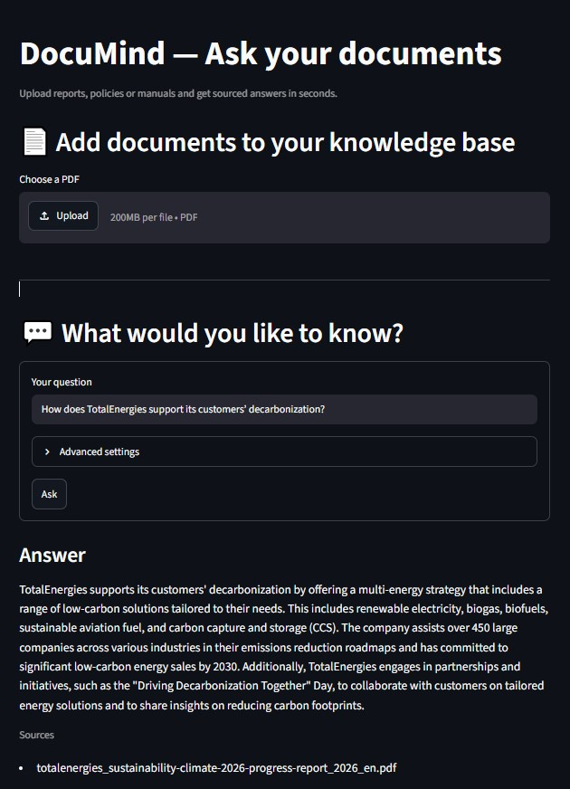
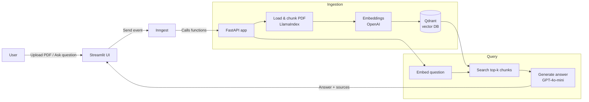

# 📚 RAG Document Assistant

Ask questions about long PDF documents and get answers grounded in their content, with sources.

This project is a **Retrieval-Augmented Generation (RAG)** application: PDFs are split into chunks, embedded and stored in a vector database. Each question retrieves the most relevant passages, which a language model uses to generate a concise, sourced answer.

**Demo use case:** analyzing climate and ESG reports from energy companies, such as TotalEnergies' 124-page *Sustainability & Climate 2026 Progress Report*.



<!-- Add your demo GIF or video here -->
<!--  -->

---

## ✨ Features

- **PDF ingestion**: upload a PDF, which is automatically chunked, embedded and stored.
- **Semantic search** over a Qdrant vector database.
- **Grounded answers**: the LLM answers using only the retrieved context, and returns the source documents.
- **Event-driven pipeline** with Inngest: each workflow runs as tracked steps, with automatic retries and observability in a dashboard.
- **Web interface** built with Streamlit for upload and Q&A.

---

## 🏗️ Architecture



**Two Inngest functions:**

| Function | Event | Steps |
|---|---|---|
| `rag_ingest_pdf` | `rag/ingest_pdf` | `load-and-chunk` → `embed-and-upsert` |
| `rag_query_pdf_ai` | `rag/query_pdf_ai` | `embed-and-search` → `llm-answer` |

---

## 🛠️ Tech Stack

| Component | Technology |
|---|---|
| API | FastAPI |
| Workflow orchestration | Inngest |
| Vector database | Qdrant (Docker) |
| PDF loading & chunking | LlamaIndex |
| Embeddings | OpenAI `text-embedding-3-large` (3072 dimensions) |
| Answer generation | OpenAI `gpt-4o-mini` |
| Data validation | Pydantic |
| User interface | Streamlit |
| Package management | uv |

---

## 📁 Project Structure

```
├── main.py             # FastAPI app and Inngest functions (ingestion + query)
├── data_loader.py      # PDF loading, chunking and embedding
├── vector_db.py        # Qdrant wrapper (collection setup, upsert, search)
├── custom_types.py     # Pydantic models for structured step outputs
├── streamlit_app.py    # Web interface
├── pyproject.toml      # Project dependencies (uv)
├── uv.lock
├── requirements.txt    # Dependencies for pip users
└── .env.example        # Environment variables template
```

---

## 🚀 Getting Started

### Prerequisites

- Python 3.11+
- [uv](https://docs.astral.sh/uv/) (or pip)
- [Docker Desktop](https://www.docker.com/products/docker-desktop/)
- [Node.js](https://nodejs.org/) (to run the Inngest Dev Server with `npx`)
- An [OpenAI API key](https://platform.openai.com/api-keys)


### 1. Configure your API key

Copy `.env.example` to `.env` and add your OpenAI key:

```
OPENAI_API_KEY=sk-...
```


### 2. Start Qdrant

Make sure Docker Desktop is running, then:

```bash
docker run -d --name qdrantRagDB -p 6333:6333 -v "$(pwd)/qdrant_storage:/qdrant/storage" qdrant/qdrant
```

Next time, simply restart the existing container:

```bash
docker start qdrantRagDB
```

The Qdrant dashboard is available at http://localhost:6333/dashboard.

### 3. Run the application

Open **three terminals** in the project folder:

**Terminal 1: FastAPI app**
```bash
uv run uvicorn main:app --reload
```

**Terminal 2: Inngest Dev Server**
```bash
npx inngest-cli@latest dev -u http://127.0.0.1:8000/api/inngest --no-discovery
```
The Inngest dashboard is available at http://127.0.0.1:8288.

**Terminal 3: Streamlit interface**
```bash
uv run streamlit run streamlit_app.py
```
The app opens at http://localhost:8501.

---

## 💬 Usage

1. Upload a PDF in the interface. Ingestion runs in the background; you can follow it in the Inngest dashboard.
2. Once ingestion is completed, ask a question.
3. The answer is displayed with its source documents.

**Example**

> **Question:** How does TotalEnergies support its customers' decarbonization?
>
> **Answer:** TotalEnergies supports its customers' decarbonization through a multi-energy strategy offering low-carbon solutions such as renewable electricity, biogas, biofuels, sustainable aviation fuel and carbon capture and storage, and helps large companies build their emissions reduction roadmaps.
>
> **Sources:** `totalenergies_sustainability-climate-2026-progress-report_2026_en.pdf`

You can also trigger the functions directly from the Inngest dashboard (**Send event**):

```json
// rag/ingest_pdf
{ "pdf_path": "path/to/document.pdf", "source_id": "document.pdf" }

// rag/query_pdf_ai
{ "question": "What are the 2030 emission reduction targets?", "top_k": 5 }
```

---
